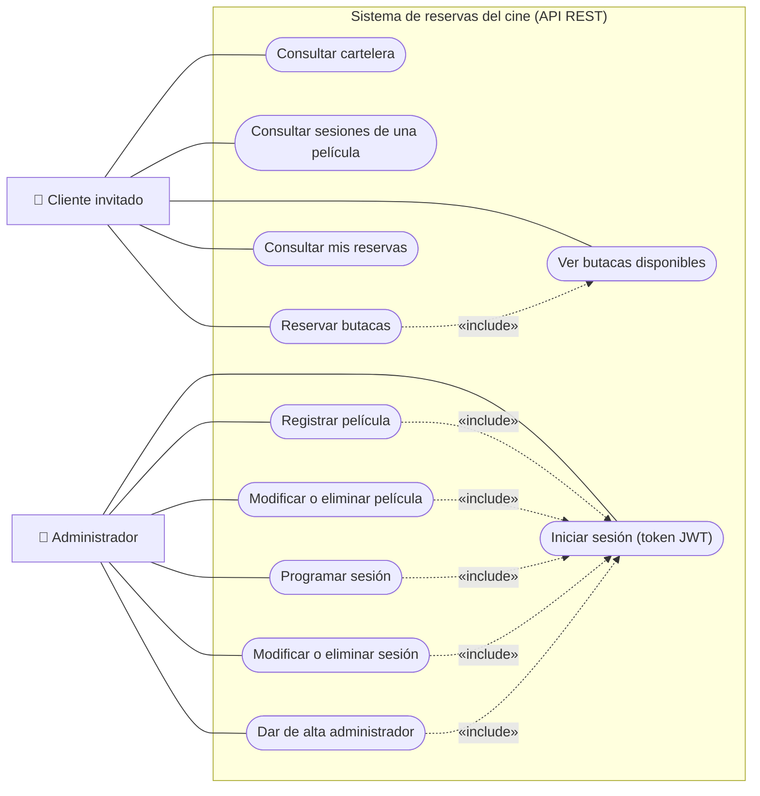
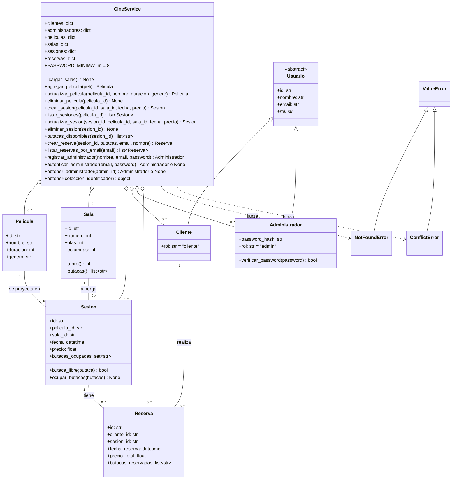
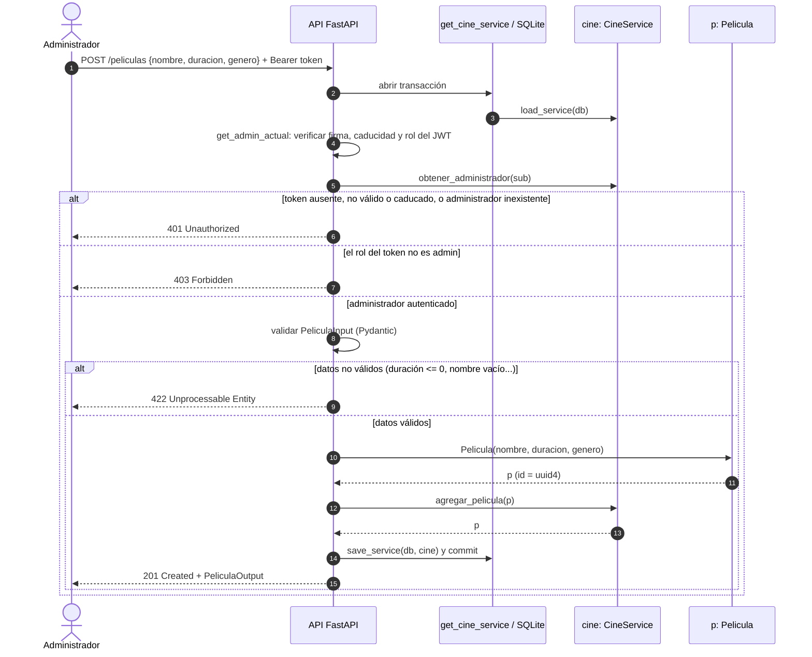
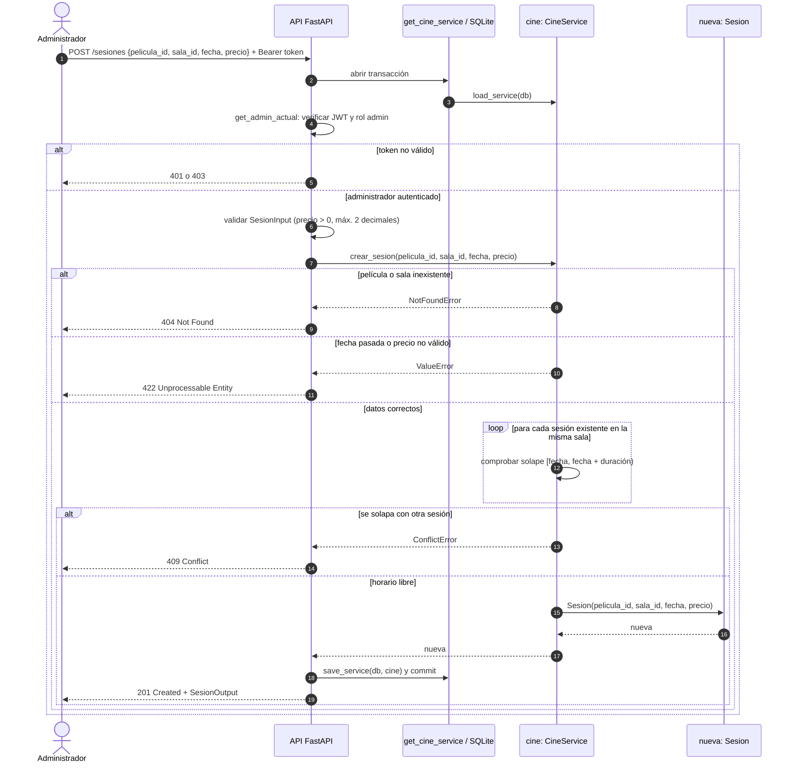
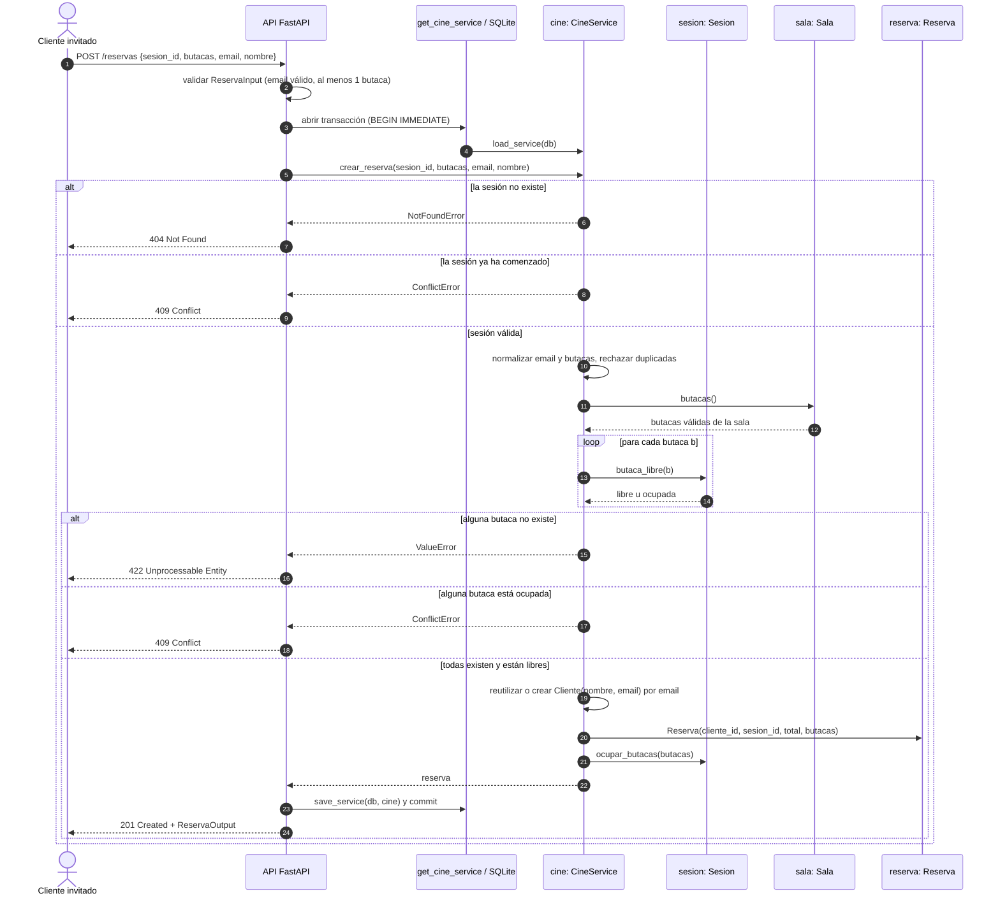
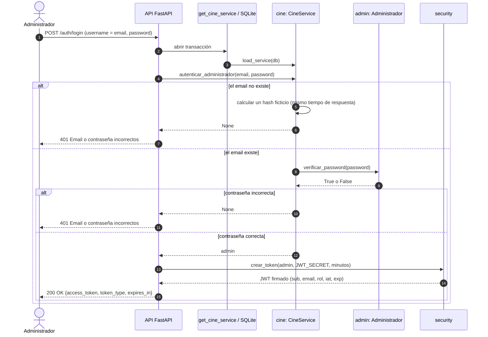

# Modelado del sistema de reservas del cine

Sección de **Modelado** de la propuesta (Proyecto, entrega 1). Incluye el diagrama
de casos de uso, el diagrama de clases y los diagramas de secuencia de los tres casos
de uso principales: **Registrar película**, **Programar sesión** y **Reservar butacas**.
Como apoyo se añade la secuencia de **Iniciar sesión**, de la que dependen las
operaciones del administrador.

Los diagramas están escritos en Mermaid, así que GitHub los muestra directamente en
este archivo. La versión para el documento está en `Modelado_cine.pdf`. Reflejan el
código con la herencia de usuarios y la autenticación JWT (`backend/cine` y
`backend/app`).

## 1. Diagrama de casos de uso

Hay dos actores. El **cliente invitado** compra sin registrarse y se identifica por
su email. El **administrador** gestiona la cartelera y la programación, y para ello
debe iniciar sesión y obtener un token JWT. Las relaciones `include` indican pasos
que siempre forman parte de otro caso de uso.

## 2. Diagrama de clases

- **Generalización (herencia):** `Cliente` y `Administrador` heredan de la clase
  abstracta `Usuario` (`cine/models/usuario.py`). Cada subclase implementa la
  propiedad abstracta `rol`. Los errores del dominio `NotFoundError` y
  `ConflictError` heredan de `ValueError`; la API los traduce a 404 y 409.
- **Agregación:** `CineService` agrupa las colecciones de películas, salas,
  sesiones, clientes, administradores y reservas. Las partes existen por sí mismas
  (se guardan en la base de datos) y el servicio solo las reúne para aplicar las
  reglas.
- **Asociaciones con multiplicidad:** una película se proyecta en `0..*` sesiones,
  una sala alberga `0..*` sesiones, una sesión tiene `0..*` reservas y un cliente
  realiza `0..*` reservas. En el código se guardan como identificadores (`*_id`).
- `Administrador` guarda solo el hash de la contraseña (`password_hash`, con
  scrypt y sal), nunca la contraseña en claro.

En `Usuario`, el atributo `rol` aparece en cursiva: en UML la cursiva indica un
miembro abstracto, que `Usuario` declara y cada subclase implementa con su valor.

## 3. Diagramas de secuencia

Siguen el recorrido real de una petición: el cliente HTTP llama a la API (FastAPI),
la dependencia `get_cine_service` carga el `CineService` desde SQLite en una
transacción, el servicio aplica las reglas y, si todo va bien, la transacción se
guarda. En las operaciones de gestión, la dependencia `get_admin_actual` comprueba
antes el token JWT. Los recuadros `alt` muestran el camino de éxito y los de error.
El tiempo avanza de arriba abajo.

### 3.1 Registrar película

### 3.2 Programar sesión

### 3.3 Reservar butacas

Es una operación pública: el cliente invitado no necesita token.

### 3.4 Iniciar sesión (apoyo)

